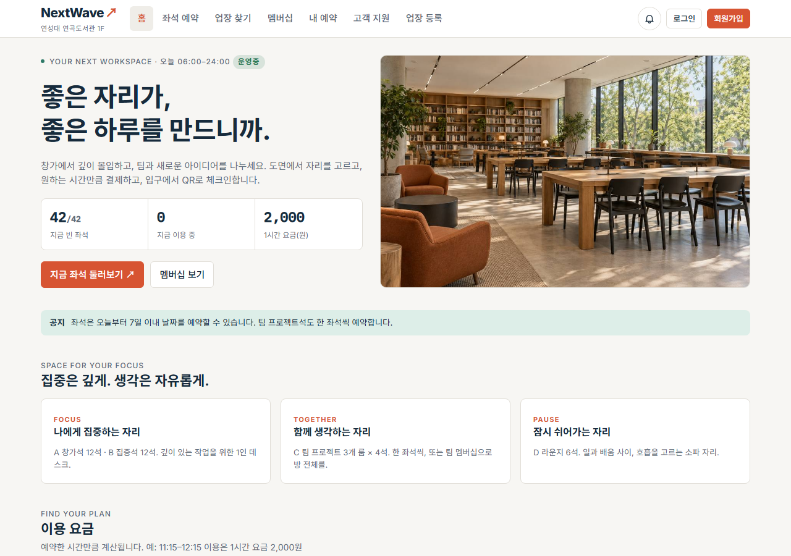
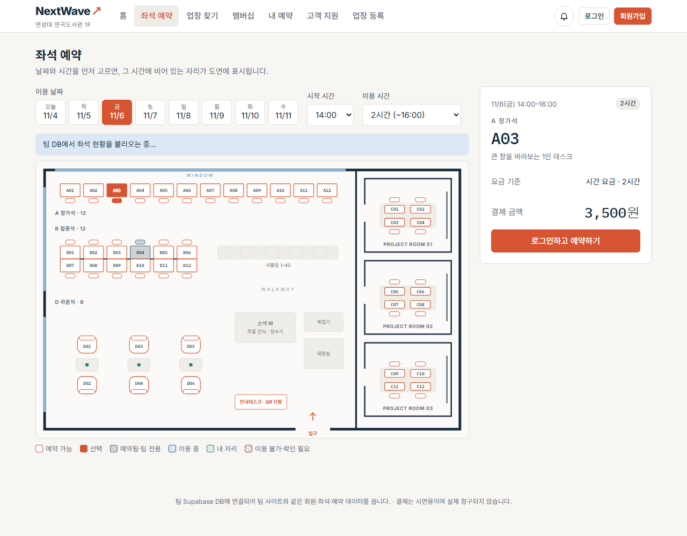
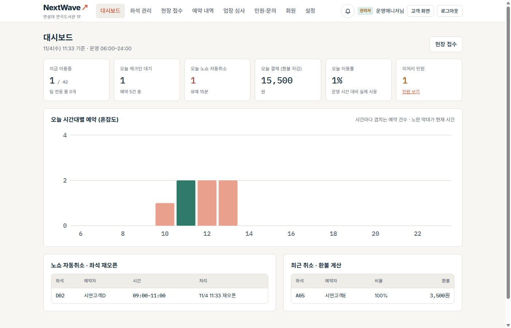
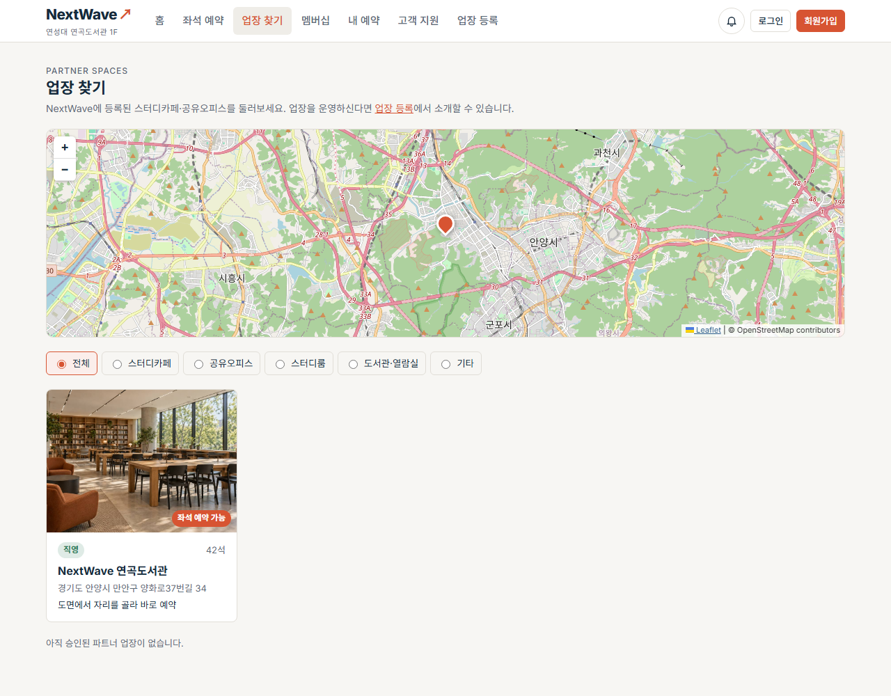
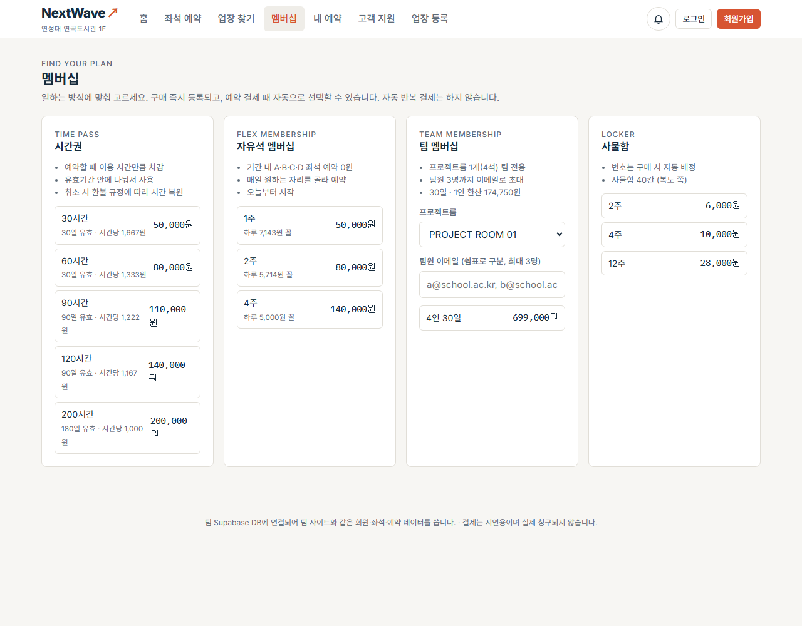
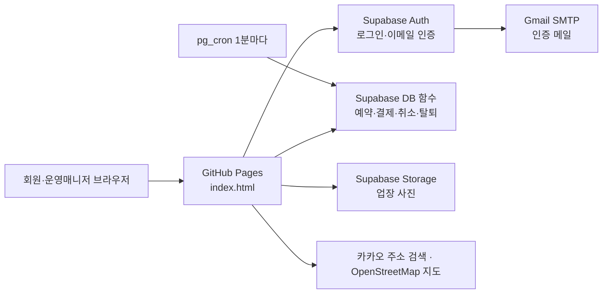

# NextWave — 공유 오피스 예약·이용현황 관리 솔루션

좌석 확인부터 예약, 결제, QR 입퇴실, 노쇼 처리, 환불, 민원, 운영 현황까지 한곳에서 처리하는 웹 서비스입니다.
클라우드캡스톤디자인2 6조 과제이며, 참여 기업은 주식회사 드림플로우입니다.

**[사이트 바로 가기](https://dlftjd6623-coder.github.io/nextwave/)** · [발표자료 내려받기](https://dlftjd6623-coder.github.io/nextwave/docs/%EB%B0%9C%ED%91%9C%EC%9E%90%EB%A3%8C_6%EC%A1%B0.pptx) · [발표 시연 순서](docs/시연-순서.md) · [요구사항 추적](docs/요구사항-추적.md) · [테스트 결과](docs/테스트-결과.md) · [DB 변경 내역](docs/DB-변경내역.md)



## 팀원

클라우드캡스톤디자인2 6조: 장용희(학생대표), 이재원, 정일성, 박성윤

## 어떤 문제를 푸나요

| 지금까지 | NextWave |
|---|---|
| 문의하거나 직접 가 봐야 빈자리를 알 수 있어 헛걸음이 생겨요 | 도면에서 날짜·시간별 빈자리를 바로 확인해요 |
| 예약을 수기로 기록해 몰리는 시간에 혼선이 생겨요 | 같은 좌석·시간의 중복 예약을 DB가 막아요 |
| 노쇼 좌석이 오래 비어 있어요 | 시작 15분까지 체크인하지 않으면 1분 안에 자동 취소하고 좌석을 다시 열어요 |
| 환불 금액 계산과 민원 처리가 수작업이에요 | 취소 시점으로 환불액을 계산하고, 민원은 상태별로 관리해요 |

## 누가 쓰나요

| 페르소나 | 상황 | 주로 쓰는 기능 |
|---|---|---|
| 박지훈 (28) · 사전예약 고객 | 출근 전 집에서 1인석을 예약하고 출발 | 도면, 예약·결제, QR 체크인 |
| 김유진 (32) · 현장 방문 고객 | 근처에서 빈자리를 찾고, 만석이면 대기 | 도면, 빈자리 알림, 즉시 예약 |
| 서준영 (35) · 운영매니저 | 데스크에서 현황을 한눈에 관리 | 대시보드, 노쇼, 환불, 민원 |

## 주요 기능

| 요구사항 | 기능 | 메뉴 |
|---|---|---|
| FR-1 | 42석 실시간 좌석 도면, 고장·청소 좌석 설정 | 좌석 예약 / 관리자 › 좌석 관리 |
| FR-2 | 7일 이내 예약, 시간별 요금, 간편결제(시연용), 대기와 빈자리 알림 | 좌석 예약 / 내 예약 / 알림 |
| FR-3 | QR 체크인·체크아웃, 노쇼 자동 취소, 반복 노쇼 예약 제한, 종료 시각 자동 퇴실 | 내 예약 / 관리자 › 설정·회원 |
| FR-4 | 취소·자동 환불 계산, 민원 접수와 답변, 현장 고객 민원 대리 접수 | 내 예약 / 고객 지원 / 관리자 › 민원·문의·현장 접수 |
| FR-5 | 이용 현황, 이용률, 시간대별 혼잡도, 노쇼·환불 내역 대시보드, 예약 내역 CSV | 관리자 › 대시보드·예약 내역 |
| 기타 | 이메일 인증 가입, 회원 탈퇴, 회원·예약 기록 삭제 | 내 정보 / 관리자 › 회원 |
| 고객 협의로 유지 | 멤버십(시간권·자유석·팀·사물함), 시간권·자유석으로 좌석 예약, 팀원 알림, 팀 프로젝트룸 0원 예약, 환불 요청과 처리 | 멤버십 / 좌석 예약 / 관리자 › 멤버십 |
| 추가 기능 | 파트너 업장 등록·심사·삭제·찾기 (주소 검색, 사진 등록) | 업장 등록 / 업장 찾기 / 관리자 › 업장 심사 |
| 편의 기능 | 지금 바로 시작, 분 단위 남은 시간, 캘린더에 추가, 지난 예약 다시 예약, 고장 좌석 대체 배정 | 내 예약 / 관리자 › 예약 내역 |

## 화면

| 좌석 예약 | 관리자 대시보드 (시연 데이터) |
|---|---|
|  |  |

| 업장 찾기 | 멤버십 |
|---|---|
|  |  |

## 어떻게 만들었나요



| 구분 | 사용 기술 |
|---|---|
| 화면 | HTML·CSS·JavaScript 단일 파일 (`index.html`) |
| 배포 | GitHub Pages |
| DB·로그인·파일 | Supabase (PostgreSQL, Auth, Storage, 행 단위 보안 RLS) |
| 자동 작업 | pg_cron (노쇼 처리 1분 주기) |
| 메일 | Gmail SMTP |
| 지도·주소 | Leaflet + OpenStreetMap, 카카오 우편번호 서비스 |

예약 규칙은 화면이 아니라 **DB 함수**에서 검사합니다. 그래서 화면을 우회해도 중복 예약이나 권한 없는 삭제가 막힙니다.

### 이벤트 설계가 실제로 동작하는 곳

| 이벤트 | 동작 | 구현 |
|---|---|---|
| E1 | 결제 승인 → 예약 확정 | `nw_pay_reservation`, `nw_pay_with_pass` |
| E2·E9 | QR 입실·퇴실 기록 | `nw_get_qr`, `nw_check_in`, `nw_check_out` |
| E3·E4 | 노쇼 자동 취소, 반복 노쇼 제한 | `nw_process_no_shows` + pg_cron, `nw_admin_clear_block` |
| E5 | 취소 시 환불 계산 | `nw_quote_cancellation`, `nw_cancel_reservation` |
| E6 | 좌석 재오픈, 도면 반영 | `refresh_seat`, `nw_seat_availability` |
| E7 | 빈자리 알림 | `nw_join_waitlist`, `nw_notifications`, `nw_cancel_waitlist` |
| E8 | 고장·청소 좌석 반영 | `nw_set_seat_status` |
| E10 | 민원 접수·상태 변경 | `nw_submit_complaint`, `nw_submit_onsite_complaint`, `nw_transition_complaint` |
| E11 | 대시보드 갱신 | `nw_admin_dashboard`, `nw_admin_reservations`, 화면 5초 갱신 |

## 실행 방법

설치할 것이 없습니다. [사이트](https://dlftjd6623-coder.github.io/nextwave/)를 열면 됩니다.

로컬에서는 `index.html`을 간단한 웹 서버로 엽니다.

```bash
python -m http.server 8000
```

## 현재 한계

발표에서 질문이 나오면 그대로 답할 수 있도록 적어 둡니다.

- **결제**는 시연용입니다. 결제 승인을 기록하지만 실제 청구와 환불은 일어나지 않습니다.
- **멤버십 구매**도 시연용 결제이며, 구매 금액 검증은 화면에서 합니다. 잔여 시간 차감과 복구는 DB 함수가 처리합니다.
- **팀원 QR**은 사이트 알림과 내 예약으로 전달하며 메일로 보내지는 않습니다. 아직 가입하지 않은 팀원의 좌석은 예약한 사람 몫으로 잡습니다.
- **멤버십 환불**은 처리 기록까지이며 실제 입금은 일어나지 않습니다.
- **현장 고객 문자**는 발송하지 않습니다. 자리가 나면 현장 접수 화면에 표시되고 운영자가 직접 안내합니다.
- **알림 읽음 표시**는 기기별로 저장됩니다.
- **요금과 예약 가능 기간**은 DB 함수에서 계산하므로 관리자 설정 화면에서는 확인만 할 수 있습니다.
- **시연용 관리자**(`admin@nextwave.kr`)는 브라우저 시연 데이터만 봅니다. 팀 DB를 보려면 등록된 관리자 계정으로 로그인해야 합니다.
- 업장 위치는 무료 지도 데이터로 찾기 때문에, 동네까지만 찾으면 핀을 직접 옮겨야 합니다.
